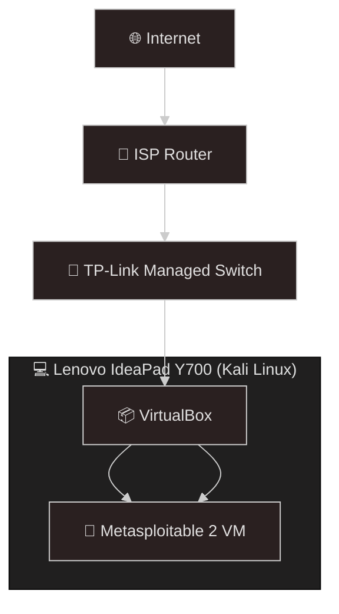

  

    <h1>⚗️ Home SOC Lab 🪨</h1>

Welcome to Kyanite! 👋 My personal Security Operations Center (SOC) lab, created to explore and practice real-world cybersecurity operations from a home environment. Using security tools, attack simulations, and investigative workflows I am developing hands-on experience in **threat detection, incident response, log analysis, and digital forensics**. This lab serves as both a learning platform and a project portfolio, helping me build practical defensive security skills while preparing for the CompTIA CySA+ certification.  

---

## 📖 Table of Contents

- 📝 [Objectives](#-objectives)
- 🛠️ [Lab Infrastructure](#%EF%B8%8F-lab-infrastructure)
  - 🌐 [Network Topology](#-network-topology)
  - 💻 [Hardware Specifications](#-hardware-specifications)
- 🛡️ [Security Stack](#%EF%B8%8F-security-stack)
- 🚨 [Detection & Response Workflows](#-detection--response-workflows)
- 🗂️ [Planned Projects & Exercises](#%EF%B8%8F-planned-projects--exercises)
- 💼 [Key Skills Demonstrated](#-key-skills-demonstrated)
- 🔬🥼 [Lab Scenarios](#-lab-scenarios) 

---

## 📝 Objectives 

&ensp;☒ Build & maintain a functional home SOC environment.  
&ensp;☐ Develop skills in network monitoring, log analysis & threat detection.  
&ensp;☐ Perform vulnerability assessments to identify & evaluate security weaknesses.  
&ensp;☐ Conduct malware analysis & digital forensics investigations.  
&ensp;☐ Document security findings, investigative processes & remediation efforts.  
&ensp;☐ Document challenges, resolutions & key lessons learned to support continuous improvement.   

---

## 🛠️ Lab Infrastructure  

### 🌐 Network Topology 

### 💻 Hardware Specifications 
| **Component** | **Details** | 
| --- | --- | 
| **Host Machine** | Secondhand Lenovo IdeaPad Y700 w/ 32GB RAM |
| **Host Operating System** | Kali Linux | 
| **Hosted Hypervisor** | VirtualBox | 
| **Virtual Machines** | Kali Linux, Metasploitable 2 | 

---

## 🛡️ Security Stack

&emsp;➔ Wireshark  
&emsp;➔ Volatility 3  
&emsp;➔ Snort  

---

## 🚨 Detection & Response Workflows 

This lab is designed around the following SOC workflows: 

1. Log Collection
2. Alert Generation
3. Investigation
4. Evidence Collection
5. Incident Documentation
6. Remediation Validation

---

## 🗂️ Planned Projects & Exercises 

&ensp;☐ Deploying & Tuning Snort IDS  
&ensp;☐ Network Traffic Analysis w/ Wireshark  
&ensp;☐ Vulnerability Assessment of Metasploitable 2  
&ensp;☐ Threat Detection & Alert Investigation  
&ensp;☐ Digital Forensics & Incident Response  
&ensp;☐ Fortinet FortiGate 60D Firewall Security Hardware Research  
&ensp;☐ Wrap-Up: Lab Challenges, Troubleshooting & Lessons Learned  

---

## 💼 Key Skills Demonstrated

&emsp;➔ Security Monitoring  
&emsp;➔ Log Analysis  
&emsp;➔ Network Traffic Analysis  
&emsp;➔ Incident Response  
&emsp;➔ Linux Administration  
&emsp;➔ IDS/IPS Operations  
&emsp;➔ Digital Forensics  
&emsp;➔ Documentation & Reporting  

---

## 🔬🥼 Lab Scenarios

Scenario 1: Port Scan Detection [Project Documentation Link]

&emsp;➔ Generated traffic with Nmap  
&emsp;➔ Triggered IDS alerts  
&emsp;➔ Investigated logs  

  

 
